# System Architecture

Jumble Sale is a production-grade retail discount discovery and promotion platform built for the Pakistani retail market. It operates as a multi-tier, cross-platform mobile application powered by Expo/React Native, Supabase (PostgreSQL, Row-Level Security, Edge Functions, pgvector, pg_cron, and Storage), and Google Gemini AI.

---

## High-Level Architecture Diagram

```mermaid
flowchart TD
  subgraph ClientTier["Client Tier (Expo / React Native / Web)"]
    ConsumerApp["Consumer App<br/>(Discovery, Feed, AI Search, Bookmarks)"]
    BrandPortal["Brand Portal<br/>(Deal Studio, Analytics Dashboard, AI Copywriter)"]
    AdminConsole["Admin Console<br/>(Brand Approvals, Deal Review, Moderation)"]
  end

  subgraph GatewayTier["API Gateway & Auth Layer (Supabase)"]
    SupabaseAuth["Supabase Auth (JWT & Role Claims)"]
    PostgREST["PostgREST (RESTful Data API + RLS Engine)"]
    StorageAPI["Supabase Storage Engine<br/>(deal-images [public], brand-docs [private])"]
  end

  subgraph EdgeRuntime["Serverless Compute Tier (Deno Edge Functions)"]
    FnChat["chat-assistant<br/>(Bilingual Intent Extraction, SQL Grounding)"]
    FnCopy["generate-promo-copy<br/>(Multi-Tone AI Copywriting)"]
    FnRec["recommendations<br/>(Hybrid Personalized Feed RPC)"]
    FnEmbed["generate-embeddings<br/>(768d Vector Generation)"]
    FnPush["send-notification<br/>(Expo Push Gateway)"]
  end

  subgraph DatabaseTier["Data & Intelligence Tier (PostgreSQL 15 + Extensions)"]
    PGCore["Core Relational Tables<br/>(profiles, brands, deals, categories)"]
    PGRls["Row-Level Security (RLS)<br/>(Tenant Isolation & Privacy)"]
    PGVector["pgvector (HNSW Index)<br/>(768d Cosine Similarity Search)"]
    PGCron["pg_cron (Background Automation)<br/>(15m Expiration, Hourly Analytics, Daily Vector Sync)"]
    PGAudit["admin_audit_log & notifications"]
  end

  subgraph ExternalTier["External Cloud Services"]
    GeminiAPI["Google Gemini 1.5 Flash & text-embedding-004"]
    ExpoPushService["Expo Push Notification Service"]
  end

  %% Client interactions
  ConsumerApp -->|JWT Authenticated Queries| PostgREST
  ConsumerApp -->|Chat Query| FnChat
  ConsumerApp -->|Request Feed| FnRec
  BrandPortal -->|Manage Deals & View KPIs| PostgREST
  BrandPortal -->|Draft Promotional Copy| FnCopy
  BrandPortal -->|Upload Verification Docs| StorageAPI
  AdminConsole -->|Audit, Approve/Reject RPCs| PostgREST

  %% Gateway to Database
  PostgREST --> PGRls
  PGRls --> PGCore
  StorageAPI --> PGRls

  %% Edge Functions to External & Internal
  FnChat -->|Extract Search Filters| GeminiAPI
  FnChat -->|Grounded Search SQL| PGCore
  FnCopy -->|Generate Creative Copy| GeminiAPI
  FnEmbed -->|Vector Embeddings| GeminiAPI
  FnEmbed -->|Store Vectors| PGVector
  FnPush -->|Dispatch Notifications| ExpoPushService

  %% Internal DB Automation
  PGCron -->|Lifecycle & Expirations| PGCore
  PGCron -->|Rollup Views & Clicks| PGCore
  PGCron -->|Trigger Push Events| FnPush
```

---

## Component Architecture Breakdown

### 1. Client Tier (Mobile & Web)
- **Framework**: Expo SDK 57 / React Native 0.86 with Expo Router (file-based navigation).
- **Navigation Layouts**:
  - `app/(consumer)/`: Consumer deals exploration, AI Assistant chat screen, saved deals, and category onboarding.
  - `app/(brand)/`: Brand management portal, deal creation wizard with AI copywriter, active deal listings, and daily engagement analytics.
  - `app/(admin)/`: Administrative control panel with audit logging, brand document review queue, deal review queue, and content moderation.
  - `app/(auth)/`: Authentication flows with role-specific routing (`consumer` vs `brand`).
- **State & Caching**: TanStack React Query v5 for server state caching, pagination, optimistic updates, and background refetching.
- **Image Optimization**: `expo-image` configured with `cachePolicy="memory-disk"` and progressive transitions.

### 2. Security & Data Isolation Layer (PostgreSQL RLS)
- **Zero Client-Side Privilege**: All database access through the anon key is governed by PostgreSQL Row-Level Security.
- **Tenant Separation**: Brands are strictly isolated; Brand A cannot view Brand B's drafts, pending deals, or daily analytics.
- **State Machine Protection**: Brands cannot set promotions to `active` directly; promotions can only be activated by admins or automated system transitions (`start_date <= NOW()`).
- **Private Storage**: `brand-docs` bucket is set to `public: false`. Access requires brand owner ownership or admin privileges verified by Postgres storage policies.

### 3. Serverless Compute Tier (Supabase Edge Functions)
- **Runtime**: Deno 1.177 runtime running on edge locations.
- **Key Edge Functions**:
  - `chat-assistant`: Bilingual (English & Roman Urdu) AI deals assistant with strict grounding in actual database records.
  - `generate-promo-copy`: Multi-tone retail copywriting engine with brand authorization and input validation.
  - `recommendations`: Edge gateway for hybrid recommendation delivery.
  - `generate-embeddings`: Computes 768-dimensional embeddings via Gemini `text-embedding-004`.
  - `send-notification`: Expo Push dispatch engine respecting per-user notification preferences.

### 4. Background Automation Tier (`pg_cron`)
- **`process_deal_lifecycle()`** (Every 15 minutes): Automatically transitions promotions with `end_date < NOW()` to `expired` and activates approved deals upon reaching their `start_date`.
- **`aggregate_daily_analytics()`** (Hourly): Rolls up raw engagement events (views, clicks, saves, likes) into `analytics_daily`.
- **`check_expiring_saved_deals()`** (Hourly): Dispatches alerts for saved deals expiring within 24 hours.
- **`refresh_all_user_preferences()`** (Daily at 03:00 UTC): Recalculates user preference vectors based on weighted historical interactions with temporal recency decay.
