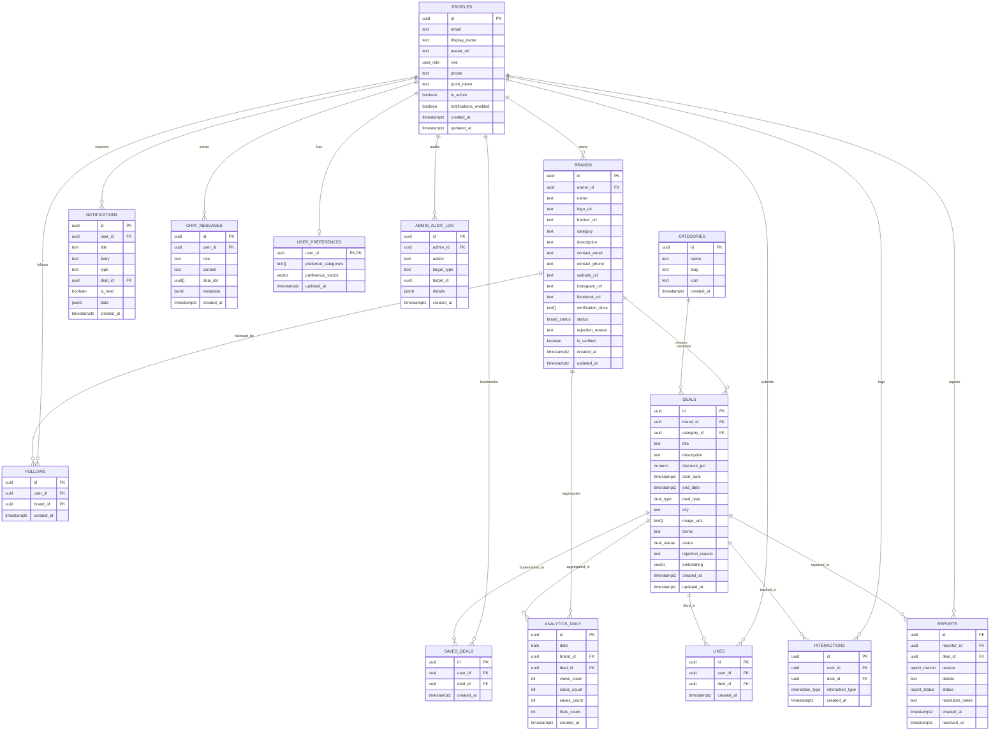

# Entity Relationship Diagram & Data Dictionary

This document details the relational schema, constraints, data types, and entity relationships implemented in PostgreSQL for Jumble Sale.

---

## Mermaid Entity Relationship Diagram

---

## Data Dictionary

### Table: `public.profiles`
| Element | Type | Validation / Constraints | Mandatory | Remarks |
|---|---|---|---|---|
| `id` | `UUID` | Primary Key, references `auth.users(id)` ON DELETE CASCADE | Yes | Direct mapping to Supabase Auth User ID. |
| `email` | `TEXT` | Valid email format, unique | Yes | User authentication email. |
| `display_name` | `TEXT` | Minimum 2 characters | Yes | Consumer name or representative full name. |
| `avatar_url` | `TEXT` | Valid URL | No | Public profile picture. |
| `role` | `user_role` | `'consumer'`, `'brand'`, or `'admin'` | Yes | Determines navigation and RLS authorization. |
| `phone` | `TEXT` | Pakistani phone format | No | Optional consumer contact number. |
| `push_token` | `TEXT` | Valid Expo Push token string | No | Registered Expo push token for notifications. |
| `is_active` | `BOOLEAN` | Default `true` | Yes | Allows admins to suspend or deactivate accounts. |
| `notifications_enabled` | `BOOLEAN` | Default `true` | Yes | User preference for receiving push notifications. |
| `created_at` | `TIMESTAMPTZ` | Default `NOW()` | Yes | Creation timestamp. |
| `updated_at` | `TIMESTAMPTZ` | Default `NOW()` | Yes | Last update timestamp. |

---

### Table: `public.brands`
| Element | Type | Validation / Constraints | Mandatory | Remarks |
|---|---|---|---|---|
| `id` | `UUID` | Primary Key, `gen_random_uuid()` | Yes | Unique identifier for brand entity. |
| `owner_id` | `UUID` | References `public.profiles(id)` ON DELETE CASCADE | Yes | Profile ID of the business owner/manager. |
| `name` | `TEXT` | Min 2 chars, max 100 chars, unique | Yes | Official registered company/brand name. |
| `logo_url` | `TEXT` | Valid image URL | No | Brand avatar / official emblem. |
| `banner_url` | `TEXT` | Valid image URL | No | Brand header image in marketplace. |
| `category` | `TEXT` | Valid retail category | Yes | Primary industry segment. |
| `description` | `TEXT` | Free text | No | Brand bio and background. |
| `contact_email` | `TEXT` | Valid email, unique | Yes | Official business contact email. |
| `contact_phone` | `TEXT` | Min 7 chars | Yes | Official business contact phone. |
| `website_url` | `TEXT` | Valid URL | No | Official website. |
| `instagram_url` | `TEXT` | Valid URL | No | Official social link. |
| `facebook_url` | `TEXT` | Valid URL | No | Official social link. |
| `verification_docs`| `TEXT[]` | Non-empty array of storage paths | Yes | Documents stored in private `brand-docs` bucket. |
| `status` | `brand_status` | `'pending'`, `'active'`, `'rejected'`, `'suspended'` | Yes | Default `'pending'`, mutable only by admin. |
| `rejection_reason`| `TEXT` | Required if status is `'rejected'` | No | Reason shown to brand upon application denial. |
| `is_verified` | `BOOLEAN` | Default `false` | Yes | Indicates admin approval and verification badge. |
| `created_at` | `TIMESTAMPTZ` | Default `NOW()` | Yes | Registration timestamp. |
| `updated_at` | `TIMESTAMPTZ` | Default `NOW()` | Yes | Last modification timestamp. |

---

### Table: `public.deals`
| Element | Type | Validation / Constraints | Mandatory | Remarks |
|---|---|---|---|---|
| `id` | `UUID` | Primary Key, `gen_random_uuid()` | Yes | Unique deal promotion ID. |
| `brand_id` | `UUID` | References `public.brands(id)` ON DELETE CASCADE | Yes | Brand publisher ID. |
| `category_id` | `UUID` | References `public.categories(id)` ON DELETE RESTRICT | Yes | Retail category classification. |
| `title` | `TEXT` | Min 5 chars, max 100 chars | Yes | Promotional heading. |
| `description` | `TEXT` | Min 10 chars | Yes | Full offer details and items included. |
| `discount_pct` | `NUMERIC` | `1 <= discount_pct <= 99` | Yes | Percentage savings offered. |
| `start_date` | `TIMESTAMPTZ` | Must be before `end_date` | Yes | Campaign commencement datetime. |
| `end_date` | `TIMESTAMPTZ` | Must be strictly after `start_date` | Yes | Campaign expiration datetime. |
| `deal_type` | `deal_type` | `'online'` or `'in_store'` | Yes | Redemption modality. |
| `city` | `TEXT` | Mandatory if `deal_type = 'in_store'` | No | City of physical redemption. |
| `image_urls` | `TEXT[]` | Array of 1 to 5 valid image URLs | Yes | Deal promotional images in `deal-images`. |
| `terms` | `TEXT` | Free text | No | Terms and conditions governing the promotion. |
| `status` | `deal_status` | `'draft'`, `'pending'`, `'active'`, `'rejected'`, `'expired'` | Yes | State machine status. Default `'pending'` on submit. |
| `rejection_reason`| `TEXT` | Free text | No | Explanation supplied by admin if rejected. |
| `embedding` | `vector(768)`| Normalized 768-dimensional float vector | No | Semantic vector generated via Gemini text-embedding. |
| `created_at` | `TIMESTAMPTZ` | Default `NOW()` | Yes | Upload timestamp. |
| `updated_at` | `TIMESTAMPTZ` | Default `NOW()` | Yes | Edit timestamp. |

---

### Table: `public.analytics_daily`
| Element | Type | Validation / Constraints | Mandatory | Remarks |
|---|---|---|---|---|
| `id` | `UUID` | Primary Key, `gen_random_uuid()` | Yes | Unique aggregation entry ID. |
| `date` | `DATE` | Valid calendar date | Yes | Aggregation rollup date. |
| `brand_id` | `UUID` | References `public.brands(id)` ON DELETE CASCADE | Yes | Denormalized brand ID for isolated queries. |
| `deal_id` | `UUID` | References `public.deals(id)` ON DELETE CASCADE | Yes | Promotion ID. |
| `views_count` | `INT` | Default `0`, non-negative | Yes | Total deal impressions recorded for the day. |
| `clicks_count`| `INT` | Default `0`, non-negative | Yes | Total detail views / clicks recorded for the day. |
| `saves_count` | `INT` | Default `0`, non-negative | Yes | Total bookmarks recorded for the day. |
| `likes_count` | `INT` | Default `0`, non-negative | Yes | Total upvotes recorded for the day. |
| `created_at` | `TIMESTAMPTZ` | Default `NOW()` | Yes | Record insertion timestamp. |
| *Constraint* | `UNIQUE (date, deal_id)` | Idempotent rollup constraint | Yes | Enforces single entry per deal per calendar date. |

---

### Table: `public.admin_audit_log`
| Element | Type | Validation / Constraints | Mandatory | Remarks |
|---|---|---|---|---|
| `id` | `UUID` | Primary Key, `gen_random_uuid()` | Yes | Unique audit record ID. |
| `admin_id` | `UUID` | References `public.profiles(id)` ON DELETE SET NULL | Yes | Admin identity who performed the operation. |
| `action` | `TEXT` | Enum strings (`APPROVE_BRAND`, `REJECT_DEAL`, etc.) | Yes | Immutable event name. |
| `target_type`| `TEXT` | `'brand'`, `'deal'`, `'profile'`, `'report'` | Yes | Entity type affected. |
| `target_id` | `UUID` | Valid UUID | Yes | Target entity identifier. |
| `details` | `JSONB` | Structured JSON object | Yes | Metadata, change payload, or rejection reason. |
| `created_at` | `TIMESTAMPTZ` | Default `NOW()` | Yes | Immutable event timestamp. |
