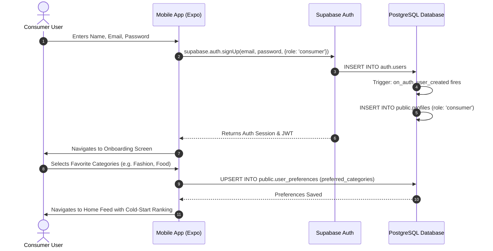
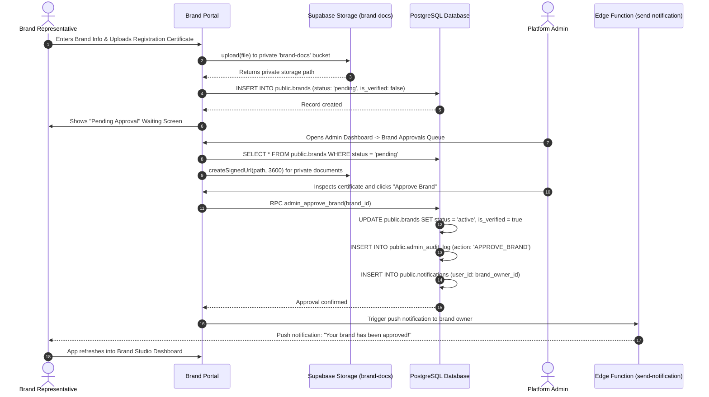
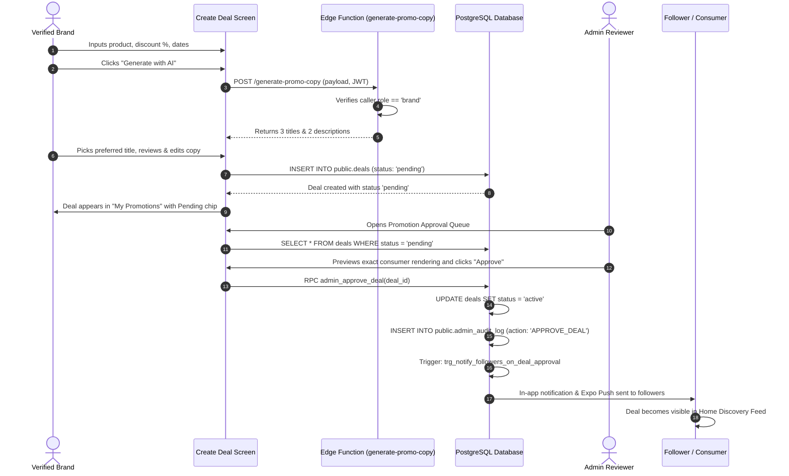
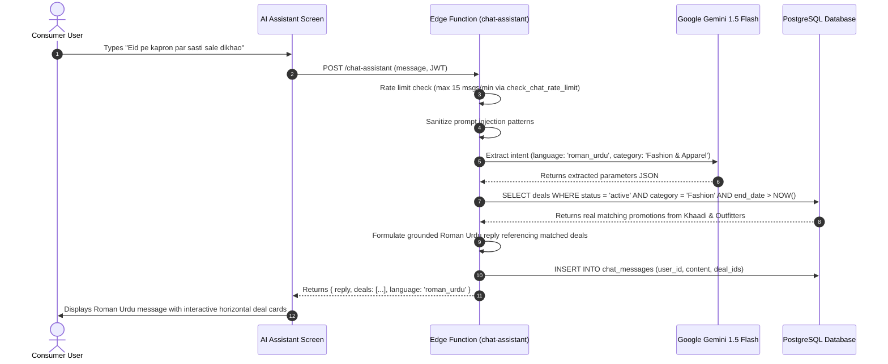
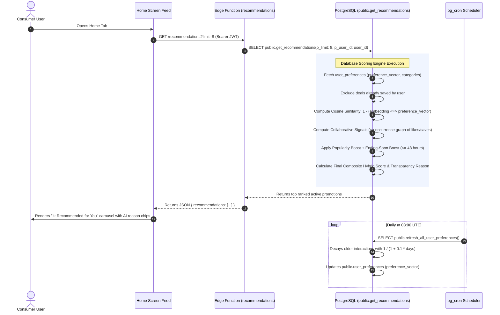

# System Sequence Diagrams

This document illustrates the end-to-end communication lifecycles across clients, Supabase services, and AI systems using Mermaid sequence diagrams.

---

## 1. User (Consumer) Registration & Onboarding Lifecycle

---

## 2. Brand Registration & Admin Approval Lifecycle

---

## 3. Promotion Upload & Admin Approval Lifecycle

---

## 4. Bilingual AI Chatbot Query Lifecycle

---

## 5. Hybrid Recommendation Generation Lifecycle

